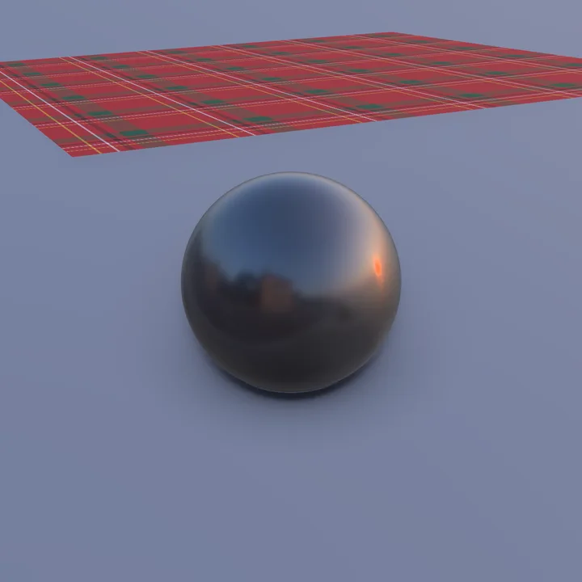
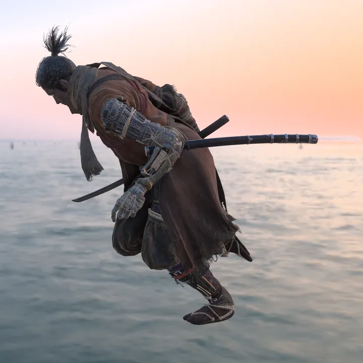

# havok-cloth

[](https://crates.io/crates/havok-cloth) [](https://docs.rs/havok-cloth) [](https://github.com/Kalmarv/havok-cloth/actions/workflows/ci.yml)

A Rust library that simulates Havok cloth data the way Sekiro and Elden Ring run it. It steps the cloth data that [havok-formats](https://github.com/Kalmarv/havok-formats) reads from the games' tagfiles and does not read files itself.

## Features

- Runs a cloth data's states as cloth instances, executing every operator class the two games' files use
- Verlet integration with substeps, damping, timestep changes and pinned particles
- Standard, stretch, compressible and bend links, bend stiffness, local range, transition and volume constraints
- Legacy and adaptive stiffness models, with legacy as the default as in the games
- Collision with spheres, capsules, tapered capsules, planes and convex geometry, with friction, moved by the bones they follow
- Virtual collision points, and landscape collision against contact planes the caller supplies
- Object-space and bone-space skinning, and mesh-to-mesh deformation through triangle frames
- Vertex operators: copy, gather, moving particles to skinned vertices, and normal, tangent and bitangent updates
- Bones driven by the simulated mesh through the mesh bone deformers
- Per-substep forces through an `Action` trait, including Elden Ring's wind action
- `f32` arithmetic in the games' operation order, with AMD's `rcpps`/`rsqrtps` estimates computed from their tables on every machine
- Identical inputs give bit-identical results on every machine, and recorded game steps replay bit for bit
- Contains no Havok SDK code

## Getting Started

### Requirements

- Rust 1.99 or newer (`rust-toolchain.toml` selects 1.99.0)
- Cloth tagfiles (`TAG0`) from your own copy of Sekiro or Elden Ring, extracted from the game's binders and DCX compression. The repository contains no game data.

### Installation

Add it together with the havok-formats version it reads:

```sh
cargo add havok-cloth havok-formats@0.9
```

### Usage

Read a tagfile with havok-formats, make an instance of each cloth data, and step it:

```rust
use havok_cloth::instance::ClothInstance;
use havok_formats::{Tagfile, cloth};

fn main() -> Result<(), Box<dyn std::error::Error>> {
    let bytes = std::fs::read("c1080_c.hkx")?;
    let physics = cloth::read(&Tagfile::read(&bytes, None)?)?;
    for data in &physics.cloths {
        let mut instance = ClothInstance::new(data)?;
        for _frame in 0..60 {
            // Before each step, set instance.transform_sets[0][i] to the world transform of bone i of the
            // skeleton with the transform set's name in the same tagfile. They stay at the identity here.
            instance.step(1.0 / 30.0, &mut [])?;
        }
        for (sim, state) in data.sim_cloths.iter().zip(&instance.sims) {
            println!("{}: first particle at {:?}", sim.name, state.positions.first());
        }
    }
    Ok(())
}
```

`ClothInstance::new` returns an error for a cloth data that uses an operator class the crate does not implement. For lower-level use, `simulate::prepare` and `simulate::simulate` step a single sim cloth, and `simulate::Action` adds forces on every substep.

The `drape` example builds a sheet in code, drops it over a ball at 30 frames per second and writes each frame as glTF (`frame_NNN.gltf`, `frame_NNN.bin` and `sheet.png`). It needs no game files:

```sh
cargo run --release --example drape -- OUT_DIR [FRAMES]
```

<p>


</p>

Run the tests with `cargo test`. The real-data and game-capture tests skip unless `GAME_DATA` names a [primase-testdata](https://github.com/Kalmarv/primase-testdata) configuration pointing at your own game files (see [tests/inputs/README.md](tests/inputs/README.md)). The wind replay is only compared on the processor its capture was recorded on. See [docs/behaviour.md](docs/behaviour.md) for the exactness rules and what the crate does not simulate, and [CONTRIBUTING.md](CONTRIBUTING.md) for the checks a change must pass. Licensed under GPL-3.0-or-later.
